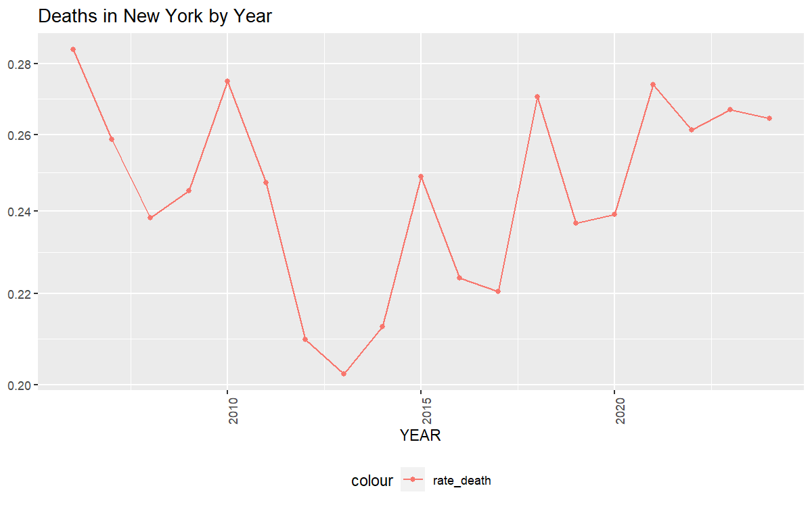
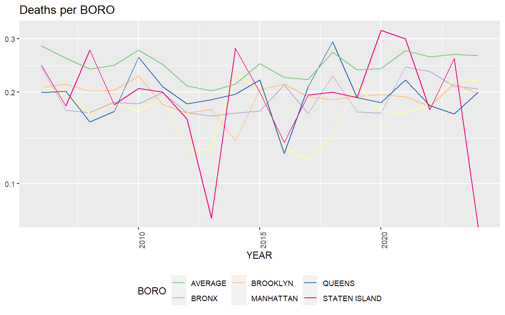
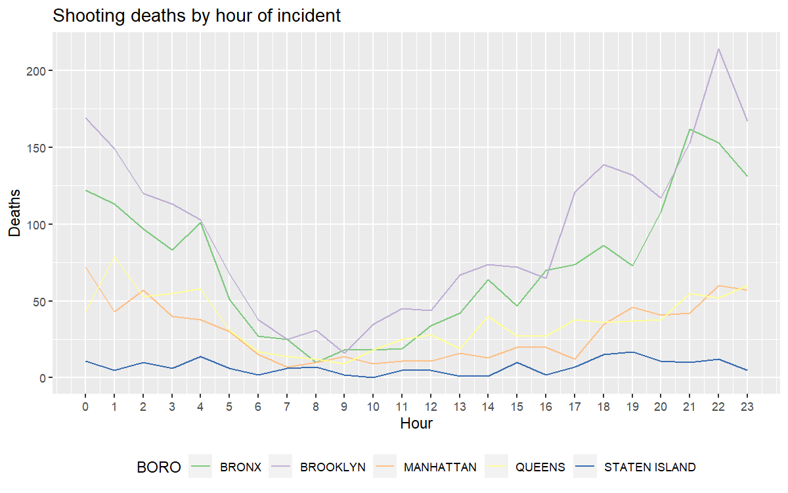
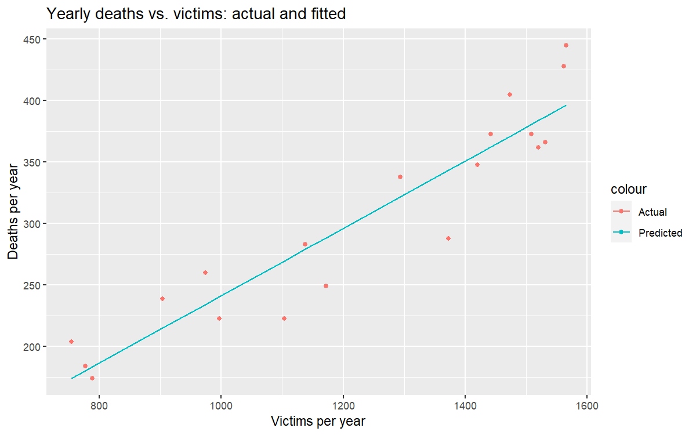

Yearly NY shooting incidents
================
2024-02-20

``` r
library(lubridate)
```

    ## 
    ## Attaching package: 'lubridate'

    ## The following objects are masked from 'package:base':
    ## 
    ##     date, intersect, setdiff, union

``` r
library(tidyverse)
```

    ## ── Attaching core tidyverse packages ──────────────────────── tidyverse 2.0.0 ──
    ## ✔ dplyr   1.1.4     ✔ readr   2.1.5
    ## ✔ forcats 1.0.0     ✔ stringr 1.5.1
    ## ✔ ggplot2 3.4.4     ✔ tibble  3.2.1
    ## ✔ purrr   1.0.2     ✔ tidyr   1.3.1

    ## ── Conflicts ────────────────────────────────────────── tidyverse_conflicts() ──
    ## ✖ dplyr::filter() masks stats::filter()
    ## ✖ dplyr::lag()    masks stats::lag()
    ## ℹ Use the conflicted package (<http://conflicted.r-lib.org/>) to force all conflicts to become errors

## R Markdown

In this markdown we explore the Dataset regarding New York shooting
incidents. We begin by reading the data in as a csv file, tidy the time
date format, sort and order, and filter the exact information that we
wish to see,

``` r
ny_cases <- read_csv("https://data.cityofnewyork.us/api/views/833y-fsy8/rows.csv?accessType=DOWNLOAD")
```

    ## Rows: 29744 Columns: 21
    ## ── Column specification ────────────────────────────────────────────────────────
    ## Delimiter: ","
    ## chr  (12): OCCUR_DATE, BORO, LOC_OF_OCCUR_DESC, LOC_CLASSFCTN_DESC, LOCATION...
    ## dbl   (5): INCIDENT_KEY, PRECINCT, JURISDICTION_CODE, Latitude, Longitude
    ## num   (2): X_COORD_CD, Y_COORD_CD
    ## lgl   (1): STATISTICAL_MURDER_FLAG
    ## time  (1): OCCUR_TIME
    ## 
    ## ℹ Use `spec()` to retrieve the full column specification for this data.
    ## ℹ Specify the column types or set `show_col_types = FALSE` to quiet this message.

``` r
ny <- ny_cases %>%
  rename(DATE = 'OCCUR_DATE', TIME = 'OCCUR_TIME') %>%
  mutate(DATE = mdy(DATE))


ny<- ny[order(ny$BORO), ]

head(ny,10)
```

<div class="kable-table">

| INCIDENT_KEY | DATE | TIME | BORO | LOC_OF_OCCUR_DESC | PRECINCT | JURISDICTION_CODE | LOC_CLASSFCTN_DESC | LOCATION_DESC | STATISTICAL_MURDER_FLAG | PERP_AGE_GROUP | PERP_SEX | PERP_RACE | VIC_AGE_GROUP | VIC_SEX | VIC_RACE | X_COORD_CD | Y_COORD_CD | Latitude | Longitude | Lon_Lat |
|---:|:---|:---|:---|:---|---:|---:|:---|:---|:---|:---|:---|:---|:---|:---|:---|---:|---:|---:|---:|:---|
| 231974218 | 2021-08-09 | 01:06:00 | BRONX | NA | 40 | 0 | NA | NA | FALSE | NA | NA | NA | 18-24 | M | BLACK | 1006343 | 234270.0 | 40.80967 | -73.92019 | POINT (-73.92019278899994 40.80967347200004) |
| 255028563 | 2022-12-02 | 22:57:00 | BRONX | OUTSIDE | 47 | 0 | STREET | GROCERY/BODEGA | FALSE | (null) | (null) | (null) | 25-44 | M | BLACK | 1020691 | 257125.0 | 40.87235 | -73.86823 | POINT (-73.868233 40.872349) |
| 72616285 | 2010-05-09 | 01:58:00 | BRONX | NA | 46 | 0 | NA | MULTI DWELL - APT BUILD | TRUE | 25-44 | M | BLACK | \<18 | F | BLACK | 1009854 | 247502.6 | 40.84598 | -73.90746 | POINT (-73.90746098599993 40.84598358900007) |
| 85875439 | 2012-07-22 | 21:35:00 | BRONX | NA | 42 | 2 | NA | MULTI DWELL - PUBLIC HOUS | FALSE | 18-24 | M | BLACK | 18-24 | M | BLACK | 1011047 | 239814.2 | 40.82488 | -73.90318 | POINT (-73.90317908399999 40.82487781900005) |
| 25036119 | 2006-10-30 | 00:20:00 | BRONX | NA | 40 | 0 | NA | NA | FALSE | 25-44 | M | BLACK HISPANIC | \<18 | M | BLACK HISPANIC | 1008973 | 233961.0 | 40.80882 | -73.91069 | POINT (-73.91069333199994 40.80881838500005) |
| 69758511 | 2010-01-10 | 02:08:00 | BRONX | NA | 42 | 2 | NA | MULTI DWELL - PUBLIC HOUS | FALSE | UNKNOWN | M | BLACK | 18-24 | M | BLACK | 1009945 | 244103.4 | 40.83665 | -73.90714 | POINT (-73.90714487499997 40.83665363500006) |
| 79489506 | 2011-06-24 | 04:36:00 | BRONX | NA | 47 | 0 | NA | NA | TRUE | 18-24 | M | BLACK | 25-44 | M | BLACK | 1023013 | 262080.3 | 40.88595 | -73.85981 | POINT (-73.85981210199998 40.88594708000005) |
| 154617363 | 2016-07-05 | 20:15:00 | BRONX | NA | 41 | 0 | NA | NA | FALSE | 18-24 | M | WHITE HISPANIC | 25-44 | M | BLACK | 1011153 | 235311.6 | 40.81252 | -73.90281 | POINT (-73.90281209999995 40.812519018000046) |
| 90104797 | 2013-04-13 | 16:28:00 | BRONX | NA | 46 | 0 | NA | NA | FALSE | NA | NA | NA | 25-44 | M | BLACK | 1007969 | 250379.5 | 40.85389 | -73.91426 | POINT (-73.91426343499995 40.85388519300005) |
| 33430214 | 2007-07-29 | 04:06:00 | BRONX | NA | 52 | 0 | NA | NA | FALSE | 18-24 | M | BLACK | 18-24 | M | WHITE HISPANIC | 1013636 | 256599.6 | 40.87094 | -73.89375 | POINT (-73.89375044799993 40.87094042100006) |

</div>

``` r
ny<- ny %>%
  select(INCIDENT_KEY:VIC_RACE) %>%
  mutate(death = as.numeric(ny$STATISTICAL_MURDER_FLAG), 
                            YEAR = as.numeric(format(ny$DATE, "%Y"))) %>%
  select(-c(LOC_CLASSFCTN_DESC, LOCATION_DESC, LOC_OF_OCCUR_DESC, JURISDICTION_CODE,
            PERP_SEX, PERP_AGE_GROUP, PERP_RACE, PRECINCT))
head(ny, 10)
```

<div class="kable-table">

| INCIDENT_KEY | DATE | TIME | BORO | STATISTICAL_MURDER_FLAG | VIC_AGE_GROUP | VIC_SEX | VIC_RACE | death | YEAR |
|---:|:---|:---|:---|:---|:---|:---|:---|---:|---:|
| 231974218 | 2021-08-09 | 01:06:00 | BRONX | FALSE | 18-24 | M | BLACK | 0 | 2021 |
| 255028563 | 2022-12-02 | 22:57:00 | BRONX | FALSE | 25-44 | M | BLACK | 0 | 2022 |
| 72616285 | 2010-05-09 | 01:58:00 | BRONX | TRUE | \<18 | F | BLACK | 1 | 2010 |
| 85875439 | 2012-07-22 | 21:35:00 | BRONX | FALSE | 18-24 | M | BLACK | 0 | 2012 |
| 25036119 | 2006-10-30 | 00:20:00 | BRONX | FALSE | \<18 | M | BLACK HISPANIC | 0 | 2006 |
| 69758511 | 2010-01-10 | 02:08:00 | BRONX | FALSE | 18-24 | M | BLACK | 0 | 2010 |
| 79489506 | 2011-06-24 | 04:36:00 | BRONX | TRUE | 25-44 | M | BLACK | 1 | 2011 |
| 154617363 | 2016-07-05 | 20:15:00 | BRONX | FALSE | 25-44 | M | BLACK | 0 | 2016 |
| 90104797 | 2013-04-13 | 16:28:00 | BRONX | FALSE | 25-44 | M | BLACK | 0 | 2013 |
| 33430214 | 2007-07-29 | 04:06:00 | BRONX | FALSE | 18-24 | M | WHITE HISPANIC | 0 | 2007 |

</div>

Here, we have a Dataset where we have the data ordered by boro, and the
deaths has been changed to a numeric format in the column “death”. The
year is extracted from date to the column “YEAR” and all other
unnecessary variables are dropped. Following this, we continue to mutate
columns to analyze the cases to death ratio and the yearly count of
each.

``` r
ny<- ny %>%
  group_by(YEAR)%>%
  mutate(cases_per_year = n_distinct(INCIDENT_KEY))


ny_by_year <- ny %>%
  group_by(YEAR)%>%
  reframe(death = sum(death), cases_per_year = cases_per_year)%>%
  mutate(deaths_per_year = death, rate_death = death/ cases_per_year)%>%
  select(deaths_per_year, YEAR, cases_per_year, rate_death)%>%
  ungroup()
  
ny_by_year <- unique(ny_by_year)

ny_by_year
```

<div class="kable-table">

| deaths_per_year | YEAR | cases_per_year | rate_death |
|----------------:|-----:|---------------:|-----------:|
|             445 | 2006 |           1566 |  0.2841635 |
|             373 | 2007 |           1442 |  0.2586685 |
|             362 | 2008 |           1520 |  0.2381579 |
|             348 | 2009 |           1420 |  0.2450704 |
|             405 | 2010 |           1473 |  0.2749491 |
|             373 | 2011 |           1509 |  0.2471836 |
|             288 | 2012 |           1373 |  0.2097597 |
|             223 | 2013 |           1103 |  0.2021759 |
|             249 | 2014 |           1172 |  0.2124573 |
|             283 | 2015 |           1138 |  0.2486819 |
|             223 | 2016 |            997 |  0.2236710 |
|             174 | 2017 |            789 |  0.2205323 |
|             204 | 2018 |            754 |  0.2705570 |
|             184 | 2019 |            777 |  0.2368082 |
|             366 | 2020 |           1531 |  0.2390594 |
|             428 | 2021 |           1562 |  0.2740077 |
|             338 | 2022 |           1294 |  0.2612056 |
|             260 | 2023 |            974 |  0.2669405 |
|             239 | 2024 |            904 |  0.2643805 |

</div>

Here we have a cleaned Dataset demonstrating the yearly count for deaths
and cases, as well as the rate of death for interest’s sake. The data is
then visualized in the following, plotting the deaths per year.

``` r
ny_by_year%>%
  ggplot(aes(x= YEAR, y = rate_death)) + 
  geom_line(aes(color= "rate_death")) + 
  geom_point(aes(color = "rate_death")) + 
  scale_y_log10() +
  theme(legend.position = "bottom",
        axis.text.x = element_text(angle = 90)) +
   labs(title = "Deaths in New York by Year", y = NULL)
```

<!-- -->

Further diving into our data, we group the information by boro to find
the yearly deaths and cases per Boro.

``` r
ny_by_boro <- ny %>%
  group_by(BORO, YEAR) %>%
  mutate(cases_per_year = n())

ny_by_boro <- ny_by_boro %>%
  group_by(BORO, YEAR) %>%
  reframe(death = sum(death), cases_per_year = cases_per_year)%>%
  mutate(D_per_BORO = death, rate_death = death/ cases_per_year)%>%
  select(D_per_BORO, BORO, YEAR, cases_per_year, rate_death)%>%
  ungroup()


ny_by_boro <- unique(ny_by_boro)

head(ny_by_boro, 10)
```

<div class="kable-table">

| D_per_BORO | BORO  | YEAR | cases_per_year | rate_death |
|-----------:|:------|-----:|---------------:|-----------:|
|        137 | BRONX | 2006 |            568 |  0.2411972 |
|         93 | BRONX | 2007 |            533 |  0.1744841 |
|         89 | BRONX | 2008 |            520 |  0.1711538 |
|         98 | BRONX | 2009 |            529 |  0.1852552 |
|         96 | BRONX | 2010 |            525 |  0.1828571 |
|        114 | BRONX | 2011 |            571 |  0.1996497 |
|         91 | BRONX | 2012 |            531 |  0.1713748 |
|         62 | BRONX | 2013 |            371 |  0.1671159 |
|         76 | BRONX | 2014 |            446 |  0.1704036 |
|         71 | BRONX | 2015 |            409 |  0.1735941 |

</div>

We take the cleaned data and visualize the information for the yearly
death rate between boros.

``` r
ggplot(NULL, aes(x = YEAR, y = rate_death))+
    geom_line(data = ny_by_boro, aes(x = YEAR, y = rate_death,
                                     color = BORO, group= BORO))+
    geom_line(data=ny_by_year, aes(color = "AVERAGE")) +
    scale_color_brewer(palette="Accent")+
    scale_y_log10() +
  theme(legend.position = "bottom",
        axis.text.x = element_text(angle = 90)) +
   labs(title = "Deaths per BORO", y = NULL)
```

    ## Warning: Transformation introduced infinite values in continuous y-axis

<!-- -->

``` r
ny_by_hour <- ny %>%
  ungroup() %>%
  mutate(HOUR = as.numeric(TIME) %/% 3600) %>%
  group_by(BORO, HOUR) %>%
  summarise(deaths = sum(death), .groups = "drop")

ggplot(ny_by_hour, aes(x = HOUR, y = deaths, color = BORO)) +
  geom_line() +
  scale_x_continuous(breaks = 0:23) +
  scale_color_brewer(palette = "Accent") +
  theme(legend.position = "bottom") +
  labs(title = "Shooting deaths by hour of incident", x = "Hour", y = "Deaths")
```

<!-- -->

Pictured above is the graph for the count of deaths at each time of day,
visualizing the time of day with the highest deaths due to gun violence
in New York.

From the analysis we can see that the Boro does affect the death rate
due to shooting incidents. For example we can see that Brooklyn has a
higher rate of death on average than the whole of New York while
Manhattan for a majority of the years has a lower rate of death. From
our Time of Death visualization, we can also see that between the hours
of 5 P.M. to 11 P.M. the number of deaths spikes. This tells us the
concentration of deaths in New York. Breaking this down by borough, the
same overnight pattern appears in every borough, though the boroughs
with more shootings overall (such as Brooklyn and the Bronx) naturally
show higher counts.

Models

``` r
mod <- lm(deaths_per_year ~ cases_per_year, data = ny_by_year)
mod
```

    ## 
    ## Call:
    ## lm(formula = deaths_per_year ~ cases_per_year, data = ny_by_year)
    ## 
    ## Coefficients:
    ##    (Intercept)  cases_per_year  
    ##       -32.6446          0.2741

``` r
ny_by_year_pred <- ny_by_year %>% mutate(pred = predict(mod))
ny_by_year_pred
```

<div class="kable-table">

| deaths_per_year | YEAR | cases_per_year | rate_death |     pred |
|----------------:|-----:|---------------:|-----------:|---------:|
|             445 | 2006 |           1566 |  0.2841635 | 396.5466 |
|             373 | 2007 |           1442 |  0.2586685 | 362.5621 |
|             362 | 2008 |           1520 |  0.2381579 | 383.9395 |
|             348 | 2009 |           1420 |  0.2450704 | 356.5326 |
|             405 | 2010 |           1473 |  0.2749491 | 371.0583 |
|             373 | 2011 |           1509 |  0.2471836 | 380.9247 |
|             288 | 2012 |           1373 |  0.2097597 | 343.6514 |
|             223 | 2013 |           1103 |  0.2021759 | 269.6529 |
|             249 | 2014 |           1172 |  0.2124573 | 288.5637 |
|             283 | 2015 |           1138 |  0.2486819 | 279.2453 |
|             223 | 2016 |            997 |  0.2236710 | 240.6017 |
|             174 | 2017 |            789 |  0.2205323 | 183.5954 |
|             204 | 2018 |            754 |  0.2705570 | 174.0030 |
|             184 | 2019 |            777 |  0.2368082 | 180.3066 |
|             366 | 2020 |           1531 |  0.2390594 | 386.9542 |
|             428 | 2021 |           1562 |  0.2740077 | 395.4504 |
|             338 | 2022 |           1294 |  0.2612056 | 322.0000 |
|             260 | 2023 |            974 |  0.2669405 | 234.2981 |
|             239 | 2024 |            904 |  0.2643805 | 215.1133 |

</div>

``` r
ggplot(ny_by_year_pred, aes(x = cases_per_year)) +
  geom_point(aes(y = deaths_per_year, color = "Actual")) +
  geom_line(aes(y = pred, color = "Predicted")) +
  labs(title = "Yearly deaths vs. victims: actual and fitted", x = "Victims per year", y = "Deaths per year")
```

<!-- --> We create a
prediction model for the yearly cases and deaths in new york and
visualize the model.

Bias:

In this project some sources of bias that I may have had are in the
lethality of guns being high and the frequency of shooting incidents
within certain Boros being higher and more lethal. In this case I chose
to ensure that each boro was reported equally and the reported cases
were not altered in any form to reflect the bias. The yearly cases and
deaths reflected the lack of lethality that I previously thought with
shooting incidents and also reflected the lower frequency of incidents
per year than I anticipated. Some Biases included as well besides
personal may be the inability to report the incident or the lack of
motivation to report incidents due to the law and fear of retaliation.
